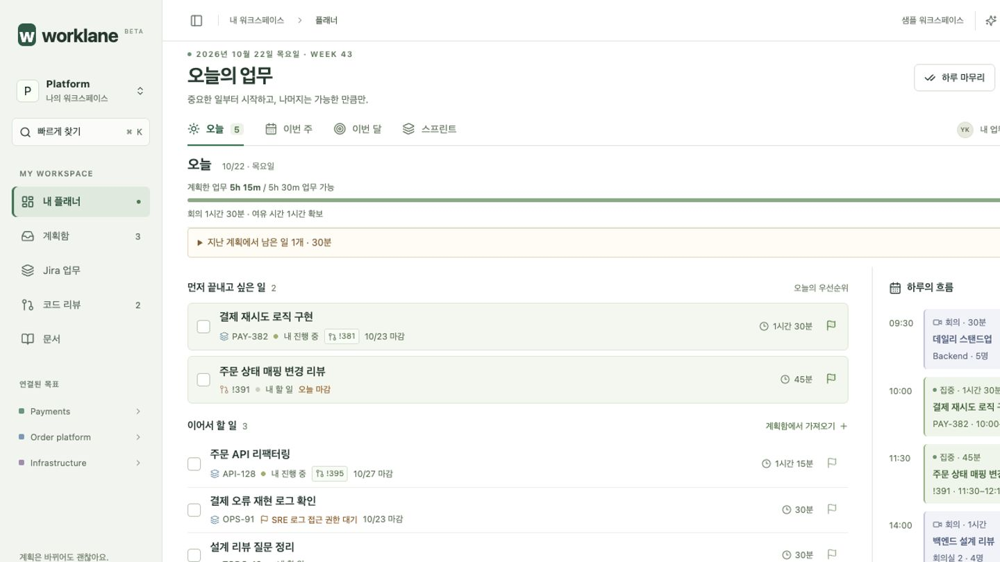
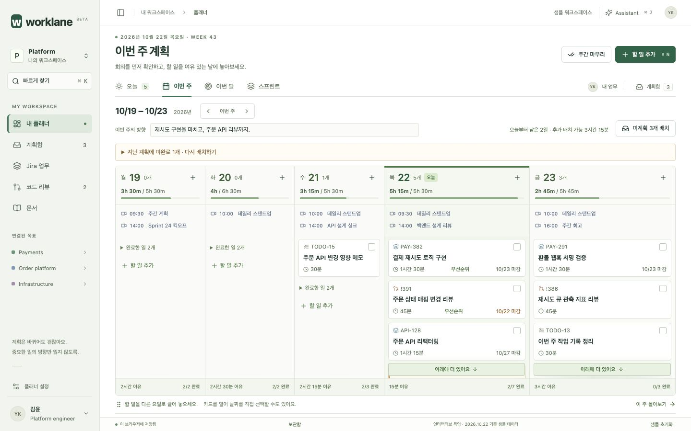
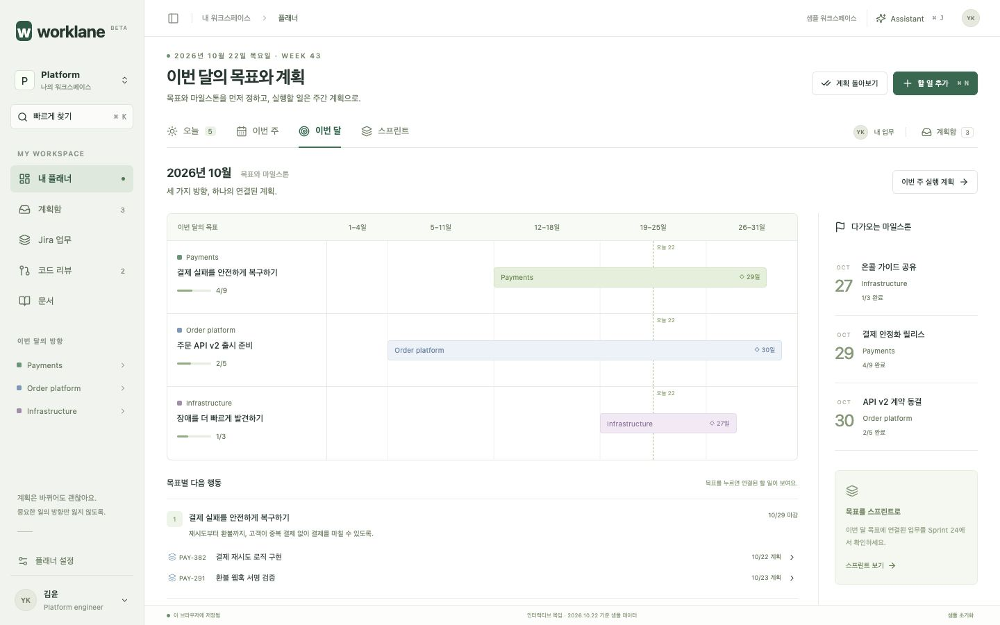
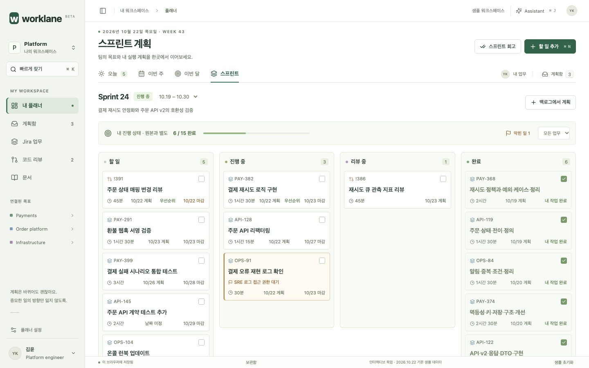

# Worklane · 업무 플래너 목업

매일 실행할 일, 주간 배치, 월간 목표, 스프린트 추적을 **하나의 태스크**로 연결하는 인터랙티브 디자인 목업입니다.

기본 진입은 **오늘**, 업무 배치는 바로 옆 **이번 주**에서 합니다. 월간·스프린트는 목표와 진행 상황을 점검할 때 사용합니다. 오늘의 상단을 압축하고, 주간의 완료 업무는 기본으로 접으며 오늘과 남은 요일에 더 넓은 공간을 배정했습니다.

## 오늘


## 이번 주


## 이번 달


## 스프린트


## 실행

```sh
cd mock
npm ci
npm run dev
```

**http://127.0.0.1:5180/**

직접 열기: `/?view=today`, `/?view=week`, `/?view=month`, `/?view=sprint`

```sh
npm run build
npm run preview
node --test src/planner-model.test.js
```

개발 서버와 프로덕션 미리보기는 같은 5180 포트를 사용하므로 하나씩 실행합니다.

## 직접 해보기

1. 할 일을 완료하고 **되돌리기**로 복원합니다.
2. 할 일을 눌러 계획 날짜와 예상 시간을 바꿉니다. 원본 마감일은 유지됩니다.
3. 이번 주에서 회의를 제외한 날짜별 가용 시간을 확인하고 계획함의 업무를 배치합니다.
4. 지난 미완료 업무를 펼쳐 날짜와 배치 후 업무량을 확인한 뒤 다시 계획합니다.
5. 다음 주·다음 달로 이동하고, 주간 방향과 월간 목표·성공 기준을 편집합니다. 목표에서 다음 행동을 추가할 수 있습니다.
6. 스프린트에서 막힌 일을 필터링하고 계획함의 업무를 선택한 스프린트에 배치합니다.
7. 일·주·월·스프린트 **마무리**에서 해당 기간의 미완료 업무와 별도로 저장되는 회고를 확인합니다.
8. 개인 할 일의 이름을 수정하고 보관합니다. 하단 **보관함**에서 복원할 수 있습니다.

단축키: `⌘/Ctrl K` 검색, `⌘/Ctrl N` 추가, `⌘/Ctrl J` Assistant, `Esc` 닫기.

## 구현과 검증

- 새 플래너: `src/PlannerMock.jsx`, `src/planner-model.js`, `src/planner.css`
- 이전 홈 디자인: `src/HomeMock.jsx`, `src/planning.js`, `src/styles.css` (실행 진입점에서는 사용하지 않음)
- [리서치 자료, 설계 결정과 테스트 기록](PLANNING_RESEARCH.md)
- [Astra 6.0 xhigh 디자이너 3명 검토와 실제 동작 검증](reviews/astra-integration.md)
- 스크린샷: 1440 × 900

모든 데이터는 2026년 10월 22일 기준 샘플입니다. 변경과 개인 기록은 이 브라우저의 `localStorage`에 저장되며, 화면 하단 **샘플 초기화**로 되돌릴 수 있습니다. 실제 Jira/GitLab/Confluence/AI 요청은 없습니다. 월간 목표는 로컬에서 수정할 수 있고 회의·근무시간은 고정 샘플입니다. 개인 진행 상태와 원본 상태 스냅샷을 분리하며, 실제 외부 상태 변경·MR 승인·코멘트 전송은 수행하지 않습니다. GitHub Pages 배포는 포함하지 않습니다.

상세 패널: [원본 상태와 개인 계획을 함께 보기](screenshots/planner-inspector.jpg). 현재 스프린트는 두 개의 샘플 기간이며 주간 보드는 월–금입니다. Undo는 가장 최근 작업 1단계입니다.
