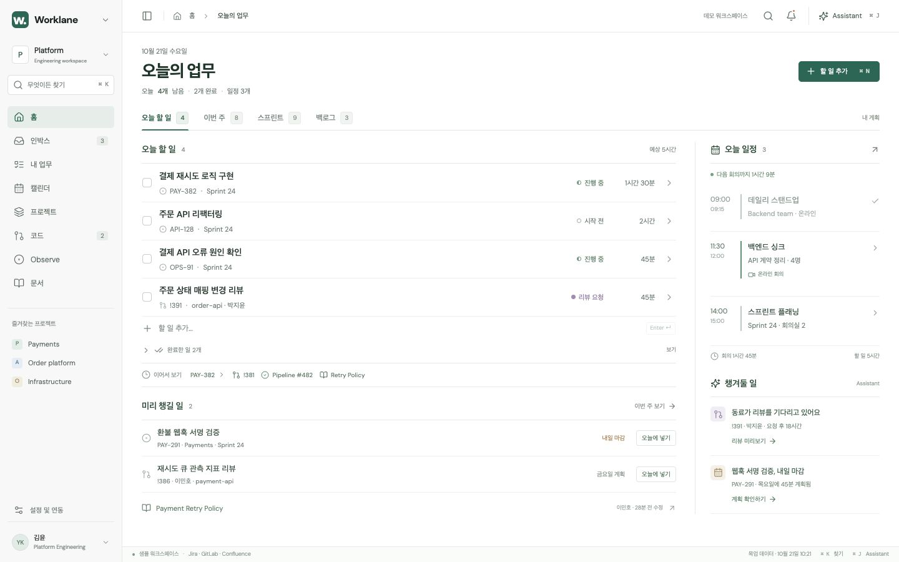

# Worklane · Home mock

홈 화면의 디자인과 업무 계획 흐름을 검토하기 위한 독립 실행 목업입니다. 실제 앱이나 연동 서버 없이 이 폴더만 실행할 수 있습니다.



## 실행

Node.js와 npm을 준비한 뒤 저장소 루트에서 실행합니다.

```sh
cd mock
npm ci
npm run dev
```

브라우저에서 **http://127.0.0.1:5180/** 을 엽니다.

```sh
npm run build
npm run preview
```

프로덕션 미리보기도 **http://127.0.0.1:5180/** 에서 열립니다. 빌드 결과는 `mock/dist/` 에 생성됩니다. 개발 서버와 미리보기 서버는 각각 실행하며, 동일 포트를 함께 사용하지 않습니다.

## 확인할 수 있는 흐름

- 오늘 할 일, 빠른 추가, 완료·완료 취소, 예정 시간과 일정
- 이번 주·스프린트·백로그 보기 및 동일한 할 일의 계획 날짜 변경
- 날짜 변경 되돌리기와 Jira 마감일 유지
- 이슈·MR·문서·파이프라인을 목록 옆에서 열어보는 미리보기
- 전역 검색, 개인 리뷰 메모, 사이드바 최소화
- 조용한 Assistant Brief와 사용자 확인을 거치는 일정 변경 예시

단축키: `⌘/Ctrl K` 검색, `⌘/Ctrl N` 빠른 추가, `⌘/Ctrl J` Assistant, `Esc` 닫기.

## 파일

```text
mock/
├── index.html
├── package.json
├── package-lock.json
├── vite.config.js
├── public/worklane.svg
├── screenshots/home.jpg
└── src/
    ├── main.jsx
    ├── HomeMock.jsx
    ├── planning.js
    └── styles.css
```

## 목업 범위

모든 이슈·일정·리뷰·파이프라인 및 AI 응답은 샘플입니다. Jira, GitLab, Confluence, Anthropic 등 외부 API를 호출하거나 토큰을 읽지 않습니다. 변경사항과 리뷰 메모는 현재 페이지의 메모리에만 유지되며 새로고침하면 초기화됩니다. 할 일 완료 표시는 개인 계획의 완료로, 실제 Jira 상태 변경이나 MR 승인이 아닙니다.

스크린샷은 1440 × 900 기준입니다. GitHub에서 이 README와 이미지를 바로 볼 수 있으며, 인터랙티브 화면은 위 실행 절차로 확인합니다. GitHub Pages 배포는 포함하지 않습니다.
